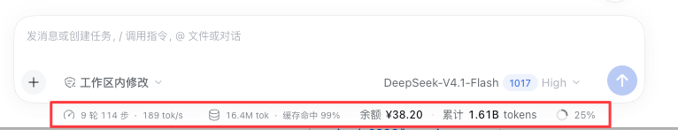

# DeepSeek Balance & Usage

**English** | [简体中文](README.md)


A DeepSeek Harness (DSH) plugin that shows the signed-in DeepSeek account's **wallet balance** and the **account-wide token total** in real time, just below the message composer in the Web UI.

```
Balance ¥49.22  ·  Total 1.55B tokens
```

<!-- Screenshot placeholder: add docs/screenshots/composer.png, then uncomment

-->

## Features

- **Balance** — the signed-in account's Platform wallets (CNY / USD), with bonus credit surfaced separately
- **Token total** — input / output / cache-read / cache-write tokens summed across every session on this machine
- **Live** — refreshes every 8 s while the page is visible, pauses in the background, refreshes on return; click to force
- **Hover details** — wallet split, the four token buckets, session count, last update
- **Native look** — host theme tokens and i18n; follows the Chinese / English UI
- **Never lies on failure** — signed out shows "Signed out", a failed read shows "No data", never a fake `0`

## Installation

Requires DSH Desktop (or any profile that provides the `deepseekAccount` and `webServer` services).

```bash
git clone https://github.com/simple0926/dsh-deepseek-account-meter.git
```

Then, from a DSH conversation, have the agent run one `plugin_manager` call with the **absolute path** of the clone:

```text
plugin_manager  action: install_bundle
                target: /absolute/path/to/dsh-deepseek-account-meter
```

**Refresh the page once** after installation, open any session, and the line appears below the composer.

<details>
<summary>Manual installation (not recommended)</summary>

`plugin_manager` performs package installation and bundle selection in one step. Doing it by hand is equivalent to:

1. linking the directory into the profile's `node_modules`;
2. adding one row to the profile's `cordis.patch.yml`:

```yaml
- insert:
    - id: deepseek-account-meter
      name: '@local/dsh-deepseek-account-meter'
```

The second step is exactly the plugin's own `cordis.patch.yml`. Use `plugin_manager` unless you are debugging installation.

</details>

### Uninstall

```text
plugin_manager  action: remove_bundle
                target: '@local/dsh-deepseek-account-meter'
```

## Usage

| Interaction | Effect |
|---|---|
| Hover | wallet split (bonus included), input / output / cache-read breakdown, session count, last update |
| Click / Enter / Space | force refresh: balance bypasses its cache, usage re-reconciles |
| Page visible | polls every 8 s |
| Back from another tab | refreshes immediately |

## How it works

```
┌─────────────────────────── Host ───────────────────────────┐
│  deepseekAccount.getBalance()   ──►  balance snapshot (60s) │
│  tokenUsage projection (folded) ──►  cross-session sum      │
│                          │                                 │
│                 webServer route (loopback only)             │
└──────────────────────────┼─────────────────────────────────┘
                           │  GET /dsh-deepseek-account-meter/summary
┌──────────────────────────┼─────────────────────────────────┐
│                    Client (composer dock)                   │
│        fetch every 8s → render one line, theme + locale     │
└────────────────────────────────────────────────────────────┘
```

- **Balance** comes from the Host service `ctx.deepseekAccount.getBalance()`, i.e. Platform's
  `GET /api/v0/users/get_user_summary`. The plugin holds no credentials and never talks to the network itself.
- **The token total is not a log rescan.** Harness already folds each session's whole log into the
  `tokenUsage` projection (from `@deepseek-ai/dsh-token-meter`) and persists it in `session_projcache`.
  The plugin only reconciles once at startup, replaces each session's absolute value from the
  projection change feed, and sums them.
- The total therefore survives restarts and **never double counts retries / replayed samples**
  (the projection folds with replacement semantics).
- Forked sessions (`isSeeded`) are skipped so inherited prefixes are not counted twice.

Data sources, measured performance, and trade-offs: [docs/DATA-SOURCES.md](docs/DATA-SOURCES.md).

## Configuration

All optional; set them in the row's `config` in the profile patch (no schema is declared, values merge over defaults):

```yaml
- id: deepseek-account-meter
  config:
    path: /dsh-deepseek-account-meter/summary   # host route path
    balanceTtlMs: 60000                          # balance cache
    balanceErrorTtlMs: 15000                     # retry delay after a failure
    clientVersion: 0.2.1-rc.5                    # x-client-version sent to Platform
    locale: zh-CN                                # x-client-locale sent to Platform
```

| Key | Default | Meaning |
|---|---|---|
| `path` | `/dsh-deepseek-account-meter/summary` | Host route path; `client.js` must change with it |
| `balanceTtlMs` | `60000` | cache lifetime of a successful balance read |
| `balanceErrorTtlMs` | `15000` | retry delay after a failed balance read |
| `clientVersion` | `0.2.1-rc.5` | `x-client-version`; DSH exposes no service for the app version, hence a config value |
| `locale` | `zh-CN` | `x-client-locale` (primary subtag picks zh_CN / en_US) |

## Privacy and permissions

- The route accepts **loopback peers only** (`127.0.0.1` / `::1`); anything else gets `403`, and only `GET`/`HEAD` are allowed.
- The plugin never reads, stores, or forwards credentials; the Platform token stays on the Host side.
- Nothing leaves the machine: the payload is balance digits and token counts.
- It appends no new session event types, renders nothing on `document.body`, and reads no other plugin's DOM.

## Compatibility

| Item | Detail |
|---|---|
| Verified on | macOS desktop DSH `0.2.1-rc.5` |
| Host dependencies | `webServer` (hard), plus optional `deepseekAccount`, `sessionPersistence`, `sessionProjections`, `sessionProjectionCache`, `sessions` |
| Client dependencies | only the platform-provided `react` and `ctx.slots`; no Harness Client package is imported |
| Build step | none — plain ESM plus the browser's `window.__ModuleLoader__`; edit a file and refresh |

If a DSH upgrade renames a service or the projection key, the widget degrades to "No data" instead of crashing.

## Known limitations

- The composer dock is a **session-scoped** slot: nothing renders on the welcome screen with no session open.
- The route serves the local page only: through a remote tunnel or a non-loopback address the line shows "No data".
- Cache reads usually dominate the total (measured: 1.52 B of 1.55 B), so the number looks larger than expected; the breakdown is in the hover tooltip.
- Subagent sessions count as ordinary sessions (correct for spend, but not split out).
- Balance caches for 60 s, so repeated clicks matter more than quick refreshes.
- A session without a projection cache row (e.g. mid format migration) is skipped rather than estimated, so the total can be slightly low.

## FAQ

**The line does not appear.**
Make sure a session is open (not the welcome screen); confirm the plugin is enabled in Settings → Plugins; refresh the page.

**It says "No data".**
Either the account is signed out (it should say "Signed out" — "No data" means a failed read) or the profile lacks a required Host service. Check your account state on the Platform usage page.

**Numbers disagree with the Platform bill.**
This widget reports the **local** session log's provider-reported usage, independent of the Platform bill. Usage from other machines or other DSH instances is not merged, and cache-read discounts are not reflected in token counts.

**Why not use the Platform usage API?**
DeepSeek exposes no public token-usage API (`usageUrl` is a human-facing page). Balance is available through the account service; usage can only come from local session records.

## Development

No build step. Three checks:

```bash
# 1. syntax
node --check index.js && node --check client.js

# 2. host route (expect 200 + JSON)
curl -s http://127.0.0.1:49325/dsh-deepseek-account-meter/summary | head -c 400

# 3. route guard
curl -o /dev/null -w '%{http_code}\n' -X POST http://127.0.0.1:49325/dsh-deepseek-account-meter/summary   # 405
```

The client registration is inspectable: under `Slots.listSubTree` for
`conversation.composer.dock` there should be an occupant with id `deepseek-account-meter`.

## Repository layout

```
dsh-deepseek-account-meter/
├── index.js                 # Host half: balance + usage aggregation + loopback route
├── client.js                # Client half: composer-dock rendering and polling
├── cordis.patch.yml         # bundle patch: inserts the host plugin row
├── package.json             # manifest with dsh.bundle / dsh.client declarations
├── locale/{zh,en}.json      # plugin-manager title and description
├── icon.svg                 # plugin icon
├── README.md / README.en.md # docs
├── CHANGELOG.md
├── LICENSE
└── docs/
    ├── DATA-SOURCES.md              # data sources and trade-offs
    ├── GITHUB_RELEASE_CHECKLIST.md  # release steps
    ├── release-notes/v1.0.0.md      # GitHub Release body
    └── screenshots/README.md        # where to put screenshots
```

## License

[MIT](LICENSE)

## Changelog

[CHANGELOG.md](CHANGELOG.md)
