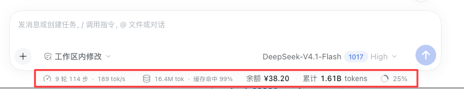

# DeepSeek 余额与用量

[English](README.en.md) | **简体中文**


一个 DeepSeek Harness（DSH）插件：在 Web 界面输入框下方，实时显示当前 DeepSeek 账户的**钱包余额**和**全账户 token 累计消耗**。

```
余额 ¥49.22  ·  累计 1.55B tokens
```



## 功能

- **账户余额**：读取当前登录的 DeepSeek 账户钱包余额（¥ / $），支持赠送余额单独展示
- **累计 token**：汇总本机全部会话的输入 / 输出 / 缓存读取 / 缓存写入 token 总量
- **实时**：页面可见时每 8 秒刷新；切到后台暂停，切回立即刷新；点击立即强制刷新
- **悬停明细**：余额拆分、四项 token 分项、会话数、更新时间
- **原生观感**：使用 Harness 主题 token 与 i18n，中文 / 英文界面自动跟随
- **失败不撒谎**：未登录显示「未登录」，读取失败显示「暂无数据」，绝不把失败伪装成 `0`

## 安装

需要 DSH Desktop（或任何加载了 `deepseekAccount` 与 `webServer` 服务的 profile）。

```bash
git clone https://github.com/simple0926/dsh-deepseek-account-meter.git
```

然后在 DSH 的对话里让 Agent 执行一条 `plugin_manager` 调用，target 用克隆下来的**绝对路径**：

```text
plugin_manager  action: install_bundle
                target: /绝对路径/dsh-deepseek-account-meter
```

安装完成后**刷新一次页面**，打开任意会话即可在输入框下方看到这一行。

<details>
<summary>手动安装（不推荐）</summary>

`plugin_manager` 会完成包安装与 bundle 选择两步。手动做等价于：

1. 把目录链接进 profile 的 `node_modules`；
2. 在 profile 的 `cordis.patch.yml` 里加一行：

```yaml
- insert:
    - id: deepseek-account-meter
      name: '@local/dsh-deepseek-account-meter'
```

第二步与插件自带的 `cordis.patch.yml` 内容相同。除非你在排查安装问题，否则请用 `plugin_manager`。

</details>

### 卸载

```text
plugin_manager  action: remove_bundle
                target: '@local/dsh-deepseek-account-meter'
```

## 使用

| 操作 | 效果 |
|---|---|
| 悬停 | 余额明细（含赠送余额）、输入 / 输出 / 缓存读取分项、会话数、更新时间 |
| 单击 / 回车 / 空格 | 立即刷新：余额绕过缓存，用量重新对账 |
| 页面可见时 | 每 8 秒自动拉取一次 |
| 切到后台再切回 | 立即刷新一次 |

## 工作原理

```
┌─────────────────────────── Host ───────────────────────────┐
│  deepseekAccount.getBalance()   ──►  余额快照（缓存 60s）    │
│  tokenUsage 投影（按会话折叠）   ──►  跨会话求和（增量更新）  │
│                          │                                 │
│                 webServer 路由（仅回环）                     │
└──────────────────────────┼─────────────────────────────────┘
                           │  GET /dsh-deepseek-account-meter/summary
┌──────────────────────────┼─────────────────────────────────┐
│                    Client（composer dock）                  │
│        每 8s fetch → 渲染一行，跟随主题与语言                 │
└────────────────────────────────────────────────────────────┘
```

- **余额**来自 Host 服务 `ctx.deepseekAccount.getBalance()`，即 Platform 的
  `GET /api/v0/users/get_user_summary`。插件不持有凭证、不自己拼请求头、不直接访问网络。
- **token 总量**不是重扫日志算的。Harness 已有 `tokenUsage` 投影（由 `@deepseek-ai/dsh-token-meter`
  提供）按会话折叠整份日志，并持久化在 `session_projcache` 里。插件只做三件事：
  启动时用投影缓存对账一次，订阅投影变更按绝对值增量替换，把各行相加。
- 因此累计值**不随重启归零**，也**不会因重试 / 重放而重复计数**（投影本身按 replacement 语义折叠）。
- fork 出来的会话（`isSeeded`）跳过，避免把继承的前缀重复计入。

更细的数据来源、实测性能和取舍见 [docs/DATA-SOURCES.md](docs/DATA-SOURCES.md)。

## 配置

全部可选，写进 profile patch 里该行的 `config`（插件未声明 schema，按原样合并到默认值）：

```yaml
- id: deepseek-account-meter
  config:
    path: /dsh-deepseek-account-meter/summary   # 路由路径
    balanceTtlMs: 60000                          # 余额缓存时长
    balanceErrorTtlMs: 15000                     # 失败后的重试间隔
    clientVersion: 0.2.1-rc.5                    # 发给 Platform 的 x-client-version
    locale: zh-CN                                # 发给 Platform 的语言
```

| 键 | 默认值 | 说明 |
|---|---|---|
| `path` | `/dsh-deepseek-account-meter/summary` | Host 路由路径，改动后需同步改 `client.js` |
| `balanceTtlMs` | `60000` | 余额成功结果的缓存时长 |
| `balanceErrorTtlMs` | `15000` | 余额失败后的重试间隔 |
| `clientVersion` | `0.2.1-rc.5` | Platform 请求头 `x-client-version`；DSH 没有暴露版本号的服务，故为配置项 |
| `locale` | `zh-CN` | Platform 请求头 `x-client-locale`（主语言子标签决定 zh_CN / en_US） |

## 隐私与权限

- 路由**只接受回环地址**（`127.0.0.1` / `::1`），非本机请求返回 `403`；只接受 `GET`/`HEAD`。
- 插件不读取、不存储、不转发任何凭证；Platform token 始终留在 Host 侧。
- 数据不出本机：返回值只有余额数字与会话 token 计数。
- 不写入任何新的事件类型，不在 `document.body` 上挂渲染，不读取其它插件的 DOM。

## 兼容性

| 项目 | 说明 |
|---|---|
| 验证环境 | macOS 桌面版 DSH `0.2.1-rc.5` |
| Host 依赖 | `webServer`（硬依赖）、`deepseekAccount`、`sessionPersistence`、`sessionProjections`、`sessionProjectionCache`、`sessions`（均为可选，缺失则降级） |
| Client 依赖 | 只依赖平台内置的 `react` 与 `ctx.slots`，不引入任何 Harness Client 包 |
| 构建步骤 | 无。纯 ESM + 浏览器端 `window.__ModuleLoader__`，改完文件刷新即生效 |

DSH 升级后如果服务名或投影键变化，会表现为「暂无数据」而不是崩溃。

## 已知限制

- composer dock 是**会话内**槽位：没有打开会话的欢迎页不显示这一行。
- 路由只服务本机页面：通过远程隧道 / 非回环地址打开界面时显示「暂无数据」。
- 累计 token 里**缓存读取通常占绝大多数**（实测 15.5 亿里有 15.3 亿是 cache read），所以数值会比直觉大，分项在悬停里。
- 子代理会话按普通会话计入（从花费角度是对的，但没有单独拆分）。
- 余额缓存 60 秒：连续点击才有意义，普通刷新可能拿到 1 分钟内的旧值。
- 若某个会话没有投影缓存行（例如格式迁移中），该会话会被跳过而不是近似估算，因此可能略低于真实值。

## 常见问题

**输入框下方没有这一行？**
确认已打开一个会话（不是欢迎页）；在 Settings → Plugins 里确认插件已启用；刷新页面。

**显示「暂无数据」？**
两种原因：没有登录 DeepSeek 账号（此时应显示「未登录」，若显示「暂无数据」则是读取失败），或当前 profile 缺少所需 Host 服务。也可打开 Platform 用量页确认账号状态。

**数字对不上开放平台的账单？**
本项目统计的是**本机**会话日志里的 provider 上报用量，与开放平台账单口径独立；跨设备、跨 DSH 实例的用量不会合并，缓存读取的计费折扣也不会体现在 token 数上。

**为什么不用开放平台的用量接口？**
DeepSeek 平台没有公开的 token 用量 API（`usageUrl` 只是给人看的网页），余额可以通过账户服务拿到，用量只能来自本机会话记录。

## 开发与调试

不需要构建。三个常用检查：

```bash
# 1. 语法
node --check index.js && node --check client.js

# 2. Host 路由是否可用（应返回 200 与 JSON）
curl -s http://127.0.0.1:49325/dsh-deepseek-account-meter/summary | head -c 400

# 3. 路由守卫
curl -o /dev/null -w '%{http_code}\n' -X POST http://127.0.0.1:49325/dsh-deepseek-account-meter/summary   # 405
```

客户端注册情况可用 Harness 的 inspect 能力查看：`Slots.listSubTree` 的
`conversation.composer.dock` 下应出现 id 为 `deepseek-account-meter` 的 occupant。

## 目录结构

```
dsh-deepseek-account-meter/
├── index.js                 # Host 半边：余额 + 用量聚合 + 回环路由
├── client.js                # Client 半边：composer dock 渲染与轮询
├── cordis.patch.yml         # bundle patch：插入宿主插件行
├── package.json             # 清单，含 dsh.bundle / dsh.client 声明
├── locale/{zh,en}.json      # 插件管理页里的标题与描述
├── icon.svg                 # 插件图标
├── README.md / README.en.md # 本文档
├── CHANGELOG.md
├── LICENSE
└── docs/
    ├── DATA-SOURCES.md              # 数据来源与取舍
    ├── GITHUB_RELEASE_CHECKLIST.md  # 发布步骤
    ├── release-notes/v1.0.0.md      # GitHub Release 正文
    └── screenshots/README.md        # 截图放置说明
```

## 许可证

[MIT](LICENSE)

## 更新日志

[CHANGELOG.md](CHANGELOG.md)
